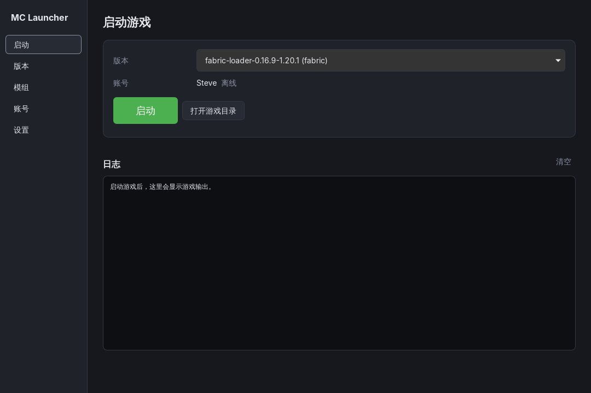
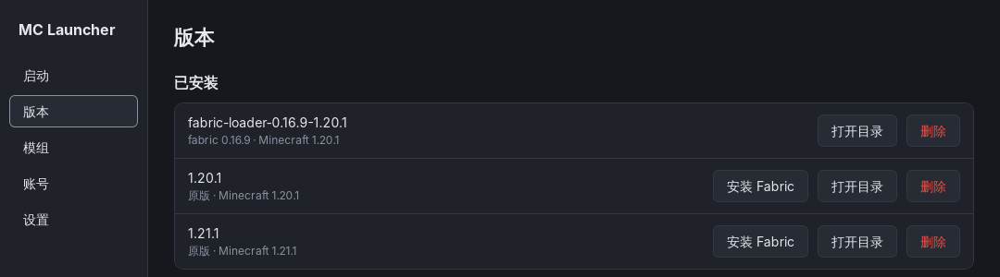

# MC Launcher

[](https://github.com/xukan5764-ai/minecraft-launcher/actions/workflows/ci.yml)
[](LICENSE)

一个开源的 Minecraft: Java 版启动器，基于 [Tauri 2](https://tauri.app/)（Rust 后端）+ React + TypeScript。体积小、跨平台（Windows / macOS / Linux）。

> 目前是雏形阶段，功能可用但还很粗糙，欢迎提 Issue 和 PR 一起完善。

<p align="center">
  
</p>
<p align="center">
  
</p>

## 功能

- **版本管理**：从 Mojang 官方列表安装正式版、快照和远古版本，支持删除；每个版本使用独立的游戏目录（版本隔离）
- **Fabric**：一键为已安装的原版安装 Fabric Loader
- **Java 自动下载**：按版本自动下载 Mojang 官方 Java 运行时（Java 8 / 17 / 21 …），也可以手动指定 Java 路径
- **账号**：微软正版登录（设备码方式），以及离线账号
- **启动**：校验并补全游戏文件、库和资源后启动，实时显示游戏日志，可以结束游戏进程
- **模组**：搜索 CurseForge 模组，自动选择匹配游戏版本和加载器的文件，并安装必需的前置模组

## 下载

预编译的安装包会发布在 [Releases](https://github.com/xukan5764-ai/minecraft-launcher/releases) 页面。还没有发布版本时，请按下面的步骤自行编译。

## 开发环境

需要先安装：

- [Node.js](https://nodejs.org/) 20 或更高版本
- [Rust](https://www.rust-lang.org/tools/install)（stable）
- Tauri 的系统依赖，见 [Tauri 前置要求](https://tauri.app/start/prerequisites/)（Windows 需要 WebView2 和 MSVC，Linux 需要 webkit2gtk 4.1 等）

```bash
npm install
cp .env.example .env   # 然后填写 .env，见下文
npm run tauri dev      # 开发模式运行
npm run tauri build    # 打包安装程序，输出在 src-tauri/target/release/bundle/
```

运行后端单元测试：

```bash
cd src-tauri
cargo test
```

## 配置 API Key

需要配置两个值：

| 变量 | 用途 | 没配置时 |
| --- | --- | --- |
| `MS_CLIENT_ID` | 微软账号登录 | 只能用离线账号 |
| `CURSEFORGE_API_KEY` | 搜索、下载 CurseForge 模组 | 模组页不可用 |

有三种配置方式，优先级从高到低：

1. **设置页**：运行时在“设置 → API 配置”里填写，保存在本机的 `config.json`
2. **编译时环境变量**：`MS_CLIENT_ID=... npm run tauri build`
3. **`.env` 文件**：项目根目录的 `.env`（已在 `.gitignore` 中，不会被提交），编译时由 `src-tauri/build.rs` 读入

第 2、3 种方式会把值写进编译出的程序里，用户拿到就能直接用。

> 注意：写进程序的值可以被提取出来。微软 Client ID 本身不是机密；CurseForge Key 被提取的风险是开源启动器的通病，主流启动器也是这样处理的。

### 微软 Client ID

**请使用你自己注册的 Client ID。** 不要使用其他启动器（如 PCL2、HMCL）的 Client ID：登录完成页显示的是 Client ID 对应的应用名（例如“你已成功登录到 PCL2”），用别人的 ID 会让用户误以为在登录别的软件，也可能违反对方和微软的使用条款。

1. 打开 [Azure 门户 → 应用注册](https://portal.azure.com/#view/Microsoft_AAD_RegisteredApps/ApplicationsListBlade)，点“新注册”
2. “名称”填写你的启动器名字（登录完成页会显示它，例如 `MC Launcher`），“受支持的帐户类型”选择 **仅限个人 Microsoft 帐户**，重定向 URI 留空
3. 创建后进入“身份验证”，把 **允许公共客户端流** 设为“是”并保存（设备码登录需要这一项）
4. 复制“概述”页的 **应用程序(客户端) ID**，填到 `MS_CLIENT_ID`
5. **向 Mojang 申请 Minecraft API 权限**：新注册的应用默认不能调用 Minecraft 登录接口，需要提交 [申请表单](https://aka.ms/mce-reviewappid)。审核通过前，登录到最后一步会提示 “Invalid app registration”。

### CurseForge API Key

在 [CurseForge for Studios 控制台](https://console.curseforge.com/) 申请 API Key，填到 `CURSEFORGE_API_KEY`。Key 里通常带有 `$`，在 `.env` 里直接粘贴即可，不需要转义；如果用 shell 环境变量传入，请用单引号括起来。

### GitHub Actions

- `ci.yml`：每次推送到 `main` 和每个 PR 都会运行前端构建、`cargo fmt`、`clippy` 和单元测试；也可以在 Actions 页手动运行，顺带构建三个平台的安装包（作为 Artifact 下载）。
- `release.yml`：推送 `v*` 标签（如 `v0.1.0`）时，在 Windows、macOS、Linux 上打包，并创建一个草稿 Release，确认无误后在网页上点发布。

打包时会从仓库 Secrets 读取 `MS_CLIENT_ID` 和 `CURSEFORGE_API_KEY`（Settings → Secrets and variables → Actions）。来自 fork 的 PR 拿不到这些 Secrets。

## 项目结构

```
src/                    前端（React + TypeScript）
  api.ts                调用后端命令的类型化封装
  state.tsx             全局状态：已安装版本、账号、进度、日志
  pages/                启动 / 版本 / 模组 / 账号 / 设置 页面
src-tauri/              后端（Rust）
  build.rs              编译时读取 .env 中的 API Key
  src/lib.rs            Tauri 命令与应用状态
  src/config.rs         设置、目录布局
  src/version.rs        版本清单、版本 JSON 解析与继承合并、规则、游戏文件下载
  src/java.rs           Mojang Java 运行时下载
  src/launch.rs         拼装启动参数、解压 natives
  src/auth.rs           微软登录（设备码 → Xbox Live → XSTS → Minecraft）与离线账号
  src/fabric.rs         Fabric 安装
  src/curseforge.rs     CurseForge 搜索与安装
  src/net.rs            并发下载、SHA1 校验、重试
```

数据目录（配置、账号、默认游戏目录）位于系统的应用数据目录下：

- Windows：`%APPDATA%\com.xukan5764ai.mclauncher`
- macOS：`~/Library/Application Support/com.xukan5764ai.mclauncher`
- Linux：`~/.local/share/com.xukan5764ai.mclauncher`

## 路线图

- [ ] Forge / NeoForge / Quilt 安装
- [ ] Modrinth 模组源、整合包导入
- [ ] 国内下载镜像（如 BMCLAPI），可在设置中切换
- [ ] 账号令牌存入系统钥匙串（目前保存在数据目录的 `accounts.json`，Unix 上权限为 600）
- [ ] 多语言、皮肤预览、启动器自动更新

## 参与贡献

欢迎提交 Issue 和 Pull Request，开发约定见 [CONTRIBUTING.md](CONTRIBUTING.md)。安全问题请按 [SECURITY.md](SECURITY.md) 私下报告。

## 许可证

[GPL-3.0](LICENSE)

本项目与 Mojang Studios、Microsoft 无关。Minecraft 是 Mojang Synergies AB 的商标。
